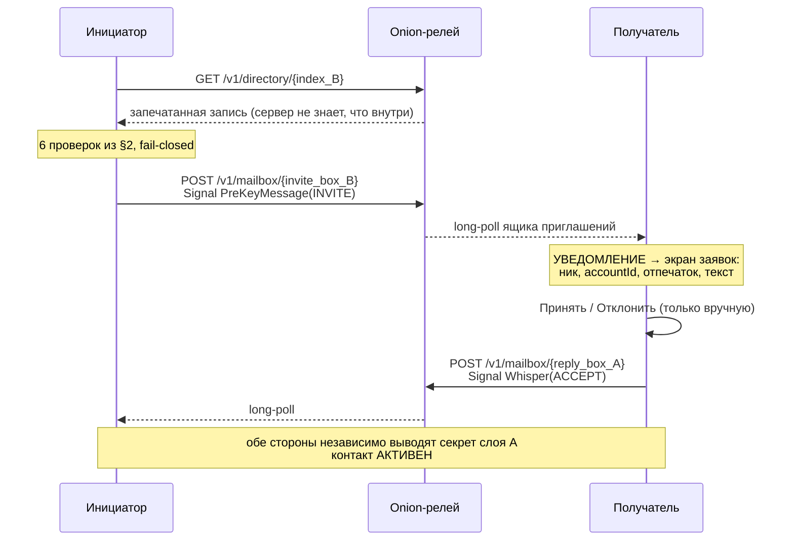

# Удалённое добавление контакта — RCH v1

> Обмен ключами БЕЗ личной встречи и без QR: по адресу контакта или публичному
> `@нику`. Дополняет личный обмен (`docs/psk_exchange.md`), не заменяет его.
> Серверная часть контракта — `aegis-server/PROTOCOL.md` §4.7–§4.9.

---

## 1. Какую задачу это решает

Личный обмен PSK требует, чтобы оба человека были в одной комнате: адрес
почтового ящика выводится **из PSK** (`rust/aegis-core/src/psk.rs`), поэтому до
появления PSK собеседнику нельзя доставить ни одного байта, а PSK без канала
доставки не согласовать. Замкнутый круг разрывал QR-код.

RCH разрывает его иначе — **тегом обнаружения**: 256 бит случайных данных,
которые владелец раздаёт вместе со своим `accountId` в виде строки-адреса. Из
тега выводятся адрес записи в каталоге и адрес ящика приглашений, поэтому первое
сообщение адресуемо ещё до всякого PSK.

---

## 2. Модель доверия: почему это не «доверие серверу»

```
accountId = "aegis:" + hex(SHA-256(ed25519_pub)[..16])
```

`accountId` — **криптографический коммитмент к ключу подписи**. Поэтому клиент,
получивший `accountId` по каналу, которому доверяет пользователь (лично, письмом,
в другом мессенджере), проверяет запись каталога сам:

1. AEAD записи открылся ключом из тега → публикатор знал тег;
2. подпись записи верна под её `ed25519`;
3. `account_id_from(ed25519) == accountId` — **привязка id к ключу**;
4. `accountId` совпал с тем, что было в адресе;
5. `tagCommitB64 == SHA-256(label ‖ tag)` — запись выпущена для ЭТОГО тега;
6. срок не истёк, а `issuedAtMs` не старше ранее принятого (анти-откат).

Все проверки **fail-closed**: любое сомнение → отказ с явным сообщением
«возможна подмена», а не мягкое «попробуйте позже».

> Известная неточность реализации (аудит 01.11.2026): запись с `expiresAtMs ≤ 0`
> `DirectoryRecordVerifier` считает бессрочной, а анти-откат действует только
> после первой принятой записи.

Отсюда следствие: чтобы подменить ключи, серверу нужен второй прообраз SHA-256
(128 бит). Полностью скомпрометированный релей способен лишь **отказать в
обслуживании** — но не выдать чужие ключи за ваши.

| | QR лично | RCH по адресу | Ник в обычном серверном реестре |
|---|---|---|---|
| Кому доверяем идентичность | глазам | строке адреса | **серверу** |
| MITM при компрометации сервера | невозможен | невозможен | **возможен** |
| Нужна физическая встреча | **да** | нет | нет |
| Перечислимость пользователей | нет | нет | **да** |

Единственное, что RCH теряет против QR: секрет слоя A больше не «физически
перенесённый независимый секрет». Это отражено в UI отдельным уровнем
`ContactTrust.REMOTE_ADDRESS` — контакт не выглядит так же, как проверенный лично.

---

## 3. Адрес контакта

```
aegis:1:<accountId-hex-32>:<tag-b64url-43>:<crc>
```

`crc` — 4 символа Crockford-Base32 от FNV-1a; ловит опечатку локально, до
обращения к сети. Криптографической роли не несёт и не подразумевает.

**Два тега, а не один** (`DiscoverySettings`):

* приватный — уходит в адрес, который выдают конкретным людям;
* публичный — раскрывается в заявке на `@ник`, то есть виден всем, кто ник угадал.

Разделение позволяет отключить «пишут по нику» ротацией публичного тега, не
обесценив адреса доверенных людей, и наоборот. Ротация приватного тега мгновенно
делает все ранее выданные адреса недействительными; существующие контакты при
этом не затрагиваются — их переписка адресуется секретом слоя A, а не тегом.

---

## 4. Производные тега

```
index      = HKDF-SHA512(salt="AEGIS/discovery/v1", ikm=tag, info="aegis/discovery/v1/index")
record_key = HKDF-SHA512(salt="AEGIS/discovery/v1", ikm=tag, info="aegis/discovery/v1/record-key")
invite_box = HKDF-SHA512(salt="AEGIS/mailbox/v2",   ikm=tag,
                         info="aegis/mailbox/v2/invite/<accountId>/<deviceId>")
reply_box  = HKDF-SHA512(salt="AEGIS/mailbox/v2",   ikm=replyTag,
                         info="aegis/mailbox/v2/reply/<accountId>/<deviceId>")
```

`invite_box` — единственный подканал, адресуемый БЕЗ PSK. Знание тега = право
прислать заявку, и ничего больше. `reply_box` выводится из **эфемерного**
`replyTag`, сгенерированного на один раунд: приняв заявку, собеседник не получает
права рассылать инициатору новые приглашения.

Домены `invite`/`reply` отделены от `conv`/`self` тестом
`psk::tests::mailbox_v2_separates_invite_and_reply_domains`.

---

## 5. Рукопожатие



`INVITE` едет **внутри Signal PreKeyMessage**, построенного на бандле из
проверенной записи: слой B аутентифицирован PQXDH сразу, новых транспортных
примитивов не появляется. По формату конверт такой же, как обычный, но несёт
`accountId` отправителя открытым текстом (§10).

Нагрузки дополнительно подписаны Ed25519-ключом аккаунта. Это не избыточность:
из тех же полей выводится секрет слоя A, и подпись делает его независимым от
libsignal — подмена поля требует взлома ещё и Ed25519. Ограничение: ACCEPT и
DECLINE не ссылаются на конкретный INVITE (нет его nonce или транскрипта),
поэтому перехваченный ответ можно «проиграть» снова и сорвать новую заявку —
содержимое это не раскрывает, но это отказ в обслуживании.

**Автоматического принятия нет ни в каком виде.** Контакт активируется только
после явного решения пользователя, и кнопок «принять» в уведомлении нет —
решение требует увидеть `accountId` и отпечаток, а из строки шторки их не видно.
Отпечаток на экране заявки копируется из сообщения отправителя и из ключей не
пересчитывается, поэтому доказательную силу имеет только `accountId`.

### Встречные заявки

Если оба отправили заявку друг другу одновременно, побеждает та, чей `accountId`
лексикографически меньше; проигравшая отменяется, а встречная авто-принимается.
Без этого правила стороны вывели бы **два разных** секрета слоя A и не сошлись бы
по адресам ящиков — то есть связи не было бы вообще.

---

## 6. Секрет слоя A: выводится, а не передаётся

```
dh_ee  = X25519(эфемерный_свой, эфемерный_чужой)     // forward secrecy
dh_ss  = X25519(статический_свой, статический_чужой)  // аутентификация accountId
kem_ss = Kyber1024 (инициатор публикует ключ, ответчик инкапсулирует)  // PQ

transcript = SHA-512("aegis/rch/v1/transcript"
    ‖ accountId_lo ‖ accountId_hi ‖ ed_lo ‖ ed_hi
    ‖ epk_lo ‖ epk_hi ‖ kem_pub ‖ kem_ct
    ‖ contrib_lo ‖ contrib_hi ‖ nonce_lo ‖ nonce_hi)

container_secret = HKDF-SHA512(
    salt = "AEGIS/psk/rch/v1",
    ikm  = dh_ee ‖ dh_ss ‖ kem_ss ‖ contrib_lo ‖ contrib_hi,
    info = "aegis/psk/rch/v1/" ‖ hex(transcript))
```

`lo`/`hi` — каноничный порядок по `accountId`, поэтому обе стороны получают один
результат независимо от того, кто инициатор. Далее секрет кладётся в существующий
`PskStore` с `PskSource.REMOTE_HANDSHAKE`, и всё ниже (mailbox v2, каскад слоя A,
звонки, `keyx`) работает без изменений.

Свойства:

* `dh_ee` — forward secrecy: эфемерные секреты удаляются после вывода;
* `dh_ss` + подписи — привязка к обоим `accountId` (аутентификация);
* `kem_ss` — post-quantum составляющая (Kyber1024 из уже аудированной libsignal,
  новых крипто-зависимостей не появилось);
* `transcript` в `info` — связывает все поля: reflection, replay и подмена
  отдельного поля исключены;
* вырожденные (low-order) чужие X25519-ключи **отвергаются**, а не дают нулевой
  вклад (тест `rejects_degenerate_x25519_public_key`).

**Независимость от libsignal сохранена:** одновременная компрометация libsignal и
релея не даёт MITM — нужно вскрыть ещё X25519 и Ed25519.

Приватные ключи не покидают Rust: `nativeRchDeriveJson` принимает мнемонику и
выводит статический X25519 и свою личность внутри, игнорируя то, что Kotlin
прислал в поле `local` (тест `rch_derive_ignores_spoofed_local_identity`).

---

## 7. Публичный `@ник` — честная цена

Индекс алиаса — `HKDF(нормализованный_ник)`, а ник низкоэнтропиен, поэтому
**словарная атака по популярным никам возможна принципиально**. Это свойство
публичного имени, а не дефект реализации.

Что утекает: «такой ник существует и указывает на такой `accountId`».
Что НЕ утекает: ключи, prekey-бандлы, список устройств, кто кого искал.
Чего сделать нельзя: подменить ключи (подпись + привязка `accountId` проверяются
клиентом заново).

Сдерживание — proof-of-work (`aegis-server/src/pow.rs`), потому что лимит по IP
за Onion Service бессмыслен: весь трафик приходит от локального tor-демона с
одного адреса. Сложность по умолчанию — 20 бит (доли секунды на GPU), и решение
можно повторно использовать для того же пути в пределах окна эпох (10–20 минут),
так что перебор словаря ников дешевле, чем кажется.

**Не работает в версии 0.4.2:** клиент кладёт ключ в поле `ed25519Hex`
(`core-common/.../contact/DirectoryRecord.kt`), а сервер требует `ed25519` —
любая заявка клиента на ник отвергается как некорректный JSON. Тесты сервера
этого не ловят, потому что собирают заявку сами.

Нормализация ника жёсткая и **запрещает не-ASCII специально**: в публичном
пространстве имён схожие символы Unicode («раyраl» вместо «paypal») — готовый
фишинг, а NFKC его не устраняет.

Режим по умолчанию — `ADDRESS` (без ника), включая пресет «Параноик».

---

## 8. Привязка к пресетам безопасности

`contactRequests` — **отдельная ось**, а не часть `keys.overSignal`. Разница
принципиальная: `keys.overSignal` разрешает ПЕРЕДАТЬ по сети готовый секрет слоя
A, здесь секрет **не передаётся** — он выводится на обеих сторонах независимо.

| Пресет | `contactRequests` |
|---|---|
| Параноик | `ADDRESS` |
| Сбалансированный | `ADDRESS_AND_ALIAS` |
| Быстрый | `ADDRESS_AND_ALIAS` |

`ADDRESS` совместим с «Параноиком» потому, что доверие сведено к подлинности
полученного вне сети адреса — то же допущение, что и для отсканированного QR.

---

## 9. Где что лежит

| Слой | Файл |
|---|---|
| Крипто RCH, теги, запись каталога | `rust/aegis-core/src/discovery.rs` |
| Домены ящиков invite/reply | `rust/aegis-core/src/psk.rs` |
| Граница JNI (JSON/base64) | `rust/aegis-core/src/lib.rs` |
| Kotlin-фасад крипты | `crypto/.../DiscoveryCrypto.kt` |
| Адрес, запись, нагрузки, уровни доверия | `core-common/.../contact/` |
| Проверка записи и заявки (fail-closed) | `app/.../contacts/DirectoryRecordVerifier.kt` |
| Поиск по адресу/нику | `app/.../contacts/DirectoryLookup.kt` |
| Оркестратор заявок | `app/.../contacts/ContactRequestManager.kt` |
| Транспорт (ящики из тега + слой B) | `app/.../contacts/ContactRequestTransport.kt` |
| Приём при НУЛЕ контактов | `app/.../contacts/InviteReceiver.kt` |
| Публикация своей записи и ника | `app/.../contacts/DirectoryPublisher.kt` |
| Хранилище заявок (СЕКРЕТЫ раунда) | `data-storage/.../ContactRequestStore.kt` |
| Теги и анти-откат (СЕКРЕТЫ) | `core-common/.../contact/DiscoverySettings.kt` |
| PoW на клиенте | `network-tor/.../PowSolver.kt` |
| UI | `app/.../ui/contacts/`, `ui/settings/ContactRequestSettingsSection.kt` |

---

## 10. Границы — честно

* **Подлинность адреса не проверяется ничем.** Если адрес получен по каналу, где
  его могли подменить, MITM возможен — ровно как при сканировании QR с
  подменённого экрана. Поэтому сверка отпечатка после активации по-прежнему
  повышает уверенность, а UI это прямо предлагает.
* **Доступность каталога не гарантируется** (zero-trust): сервер может удалить
  запись или не отдать заявку, а любой анонимный клиент — вытеснить записи
  каталога, переполнив глобальный потолок сервера. Клиент тогда откатывается на
  обмен по QR.
* **Публичный ник перечислим** (§7) — осознанное свойство, выключен по умолчанию
  и на клиенте, и на сервере.
* **Мультидевайс частично:** заявка уходит на устройство, опубликовавшее запись;
  остальные устройства получают ключи обычным путём (`device-announce`, `keyx`)
  уже после активации.
* **Ящик заявок несёт `accountId` отправителя снаружи шифртекста** — иначе
  получатель не смог бы выбрать libsignal-сессию (контакта ещё нет). Это
  локализованная уступка: в конвертах ПЕРЕПИСКИ `accountId` по-прежнему нет, а
  положить конверт в ящик заявок может только тот, кому выдан адрес (и сервер).
  Следствие: сервер видит долговременные `accountId` и отправителя заявки, и
  ответившего — то есть рёбра социального графа на уровне аккаунтов, а не
  псевдонимов.
* **PSK без ротации** не даёт forward secrecy слою A сам по себе — как и раньше
  (компенсируется слоем B).
